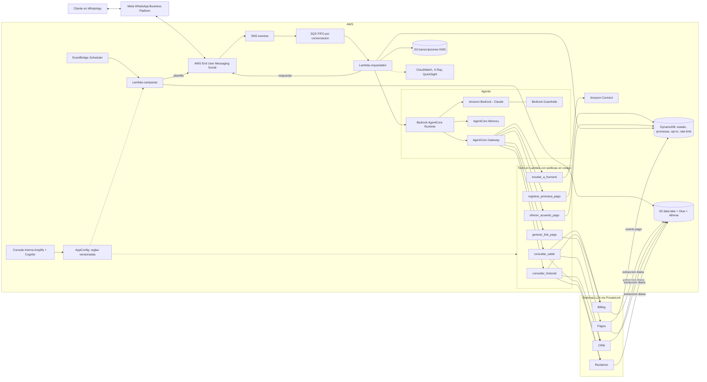
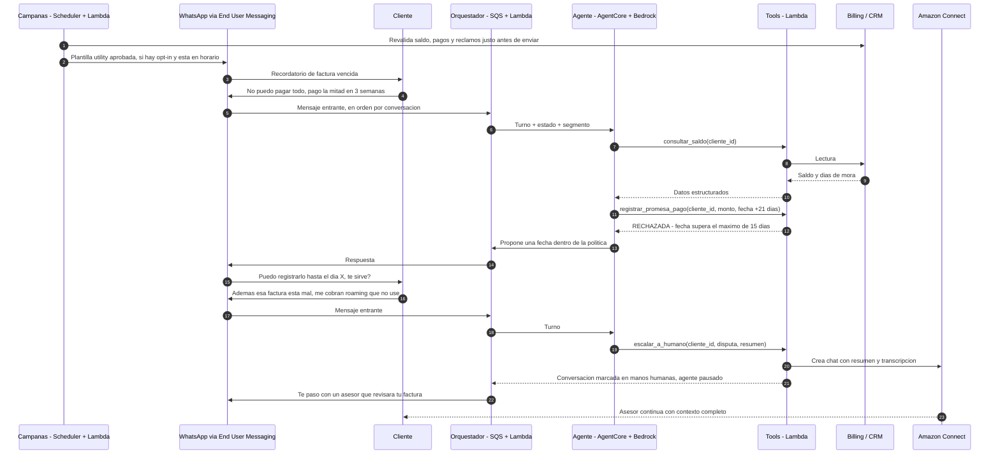
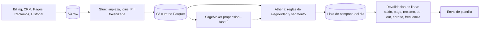
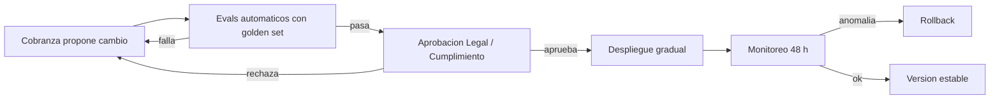
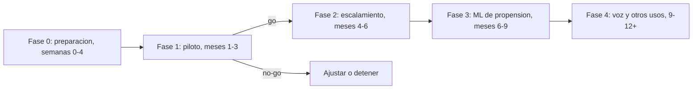

# Proyecto Ágil — Propuesta de arquitectura y estrategia

**Agentes de IA para la gestión de clientes con facturas vencidas vía WhatsApp — LLA Panamá**

| | |
|---|---|
| Audiencia | Comité de tecnología y equipo comercial |
| Autor | Felipe Echeverri — AI Engineer, líder del Proyecto Ágil |
| Estado | Propuesta para discusión — noviembre 2026 |
| Prototipo | `prototype/` (instrucciones en `prototype/README.md`) |

> **Convenciones.** (1) **Todo número de negocio de este documento es un supuesto declarado**, no un dato de LLA: volúmenes, montos, tasas y costos son ilustrativos y se reemplazan con datos reales en la fase 0. (2) Lo marcado ⚠ es un punto que confirmaré con el área dueña (Legal, Finanzas, Meta, AWS) durante la fase 0, antes de comprometer el diseño.

## Índice

0. Resumen ejecutivo
1. El problema de fondo
2. Supuestos explícitos
3. Arquitectura de alto nivel
4. ¿Cómo sabe el agente con quién hablar y qué decir?
5. ¿Cómo funciona el agente por dentro?
6. Integración con sistemas existentes
7. Gobierno y operación
8. Consideraciones legales y regulatorias (Panamá)
9. Riesgos y mitigaciones
10. Métricas y medición de impacto
11. Evaluación de calidad del agente
12. Por qué cada servicio AWS y no otro
13. Costos (ilustrativos)
14. Roadmap y criterios go/no-go
15. Equipo y modelo operativo
16. Relación con el prototipo
17. Qué haría distinto con más tiempo / en producción
18. Fuentes

---

## 0. Resumen ejecutivo

**Problema.** Cobranza hoy trabaja por llamada y correo. En los picos, el volumen de clientes en mora supera la capacidad del equipo. Los clientes que no se contactan a tiempo pasan a tramos de mora más profundos, donde recuperar es más caro y crece el riesgo de churn. WhatsApp es el canal dominante en Panamá (apertura >90 % vs. 20–30 % del correo, según el contexto del caso).

**Tesis.** El problema de fondo no es solo el volumen: **hoy todos los morosos reciben el mismo trato**. Quien olvidó pagar necesita un recordatorio y un link. Quien perdió ingresos necesita un acuerdo. Quien disputa la factura no necesita que le cobren, necesita que alguien revise su reclamo. Tratarlos igual malgasta capacidad humana en los casos fáciles y genera fricción y riesgo reputacional en los difíciles.

**Propuesta.** Un agente de IA en WhatsApp que:
1. Contacta a cada cliente según su segmento con una plantilla aprobada por Meta.
2. Mantiene una conversación real. Consulta saldo e historial, genera links de pago, registra promesas y ofrece acuerdos, solo dentro de las políticas que define el negocio.
3. Escala a un humano (Amazon Connect) con un resumen ante disputa, vulnerabilidad, pedido explícito, amenaza legal, montos altos, B2B o baja confianza.

**Principio de diseño central:** *el LLM conversa, el código decide.* Los límites (montos, plazos, cuotas) se aplican de forma determinística dentro de cada herramienta, no se confían al modelo.

Stack: 100 % AWS. AWS End User Messaging Social (WhatsApp), Amazon Bedrock con Claude + Bedrock AgentCore (agente), Lambda/SQS/DynamoDB (integración y estado), Amazon Connect (humano), S3/Glue/Athena (datos).

**Qué le pido al comité:** aprobar un **piloto de 3 meses con un solo segmento** (Olvidadizo, mora 1–30 días, residencial) **con grupo de control**, y dueños nombrados en Cobranza, Legal y TI para tres temas de ruta crítica: dictamen legal sobre el contacto por WhatsApp, verificación de la WABA y aprobación de plantillas, y acceso de lectura a billing/CRM.

---

## 1. El problema de fondo

### 1.1 Cobranza humana vs. escalable

El agente absorbe el volumen rutinario (recordatorios, links, promesas simples) para que el equipo dedique su tiempo a lo que exige juicio: disputas, vulnerabilidad, clientes empresariales y negociaciones fuera de política.

### 1.2 No todos los morosos son iguales

Variables que cambian la conversación: días de mora (1–30 / 31–60 / 61–90 / 90+), monto, historial de pago y de promesas, reclamos abiertos, tipo (residencial/B2B), valor (ARPU, antigüedad) y las señales en la propia conversación (angustia, enfermedad, desempleo).

| Segmento | Perfil típico | Estrategia | ¿El agente resuelve? |
|---|---|---|---|
| Olvidadizo | Buen historial, mora temprana | Recordatorio + `generar_link_pago` | Sí |
| Dificultad temporal | Problema puntual de liquidez | `registrar_promesa_pago` o `ofrecer_acuerdo_pago` (2–3 cuotas, si la campaña lo permite) | Sí, dentro de la política |
| Reincidente | Promesas incumplidas | Tono firme y respetuoso, sin acuerdo nuevo; link o escalar | Parcial |
| En disputa | Reclamo abierto sobre la factura o el servicio | No cobrar; escalar directo | No |
| Alto valor / B2B | Empresarial o ARPU alto | Ejecutivo humano | No |

### 1.3 Riesgo reputacional

Una mala conversación de cobranza por WhatsApp termina en un pantallazo en redes. Los escenarios que más preocupan: cobrarle a quien ya pagó, cobrarle a quien disputa, inventar un monto o un beneficio, insistir de más, escribirle a un tercero con número reasignado, o que Meta restrinja el número de LLA por quejas. Buena parte de la arquitectura existe para evitar estos escenarios.

---

## 2. Supuestos explícitos

| # | Supuesto | Impacto si es falso | Cómo validarlo |
|---|---|---|---|
| S1 | Existe una API o réplica de lectura de billing/CRM accesible desde AWS | Se usa un batch diario a S3 y se refuerza la revalidación; sube el riesgo de "ya pagó" | Taller con TI, semana 1 |
| S2 | LLA tiene o puede obtener una WABA verificada y plantillas aprobadas | Sin esto no hay mensajes salientes. Bloquea el piloto | Revisar el Business Manager; enviar plantillas en la semana 1 |
| S3 | Hay base de opt-in o una base legal válida para el primer contacto | Se capta el opt-in por otros canales antes de iniciar; se reduce el alcance | Dictamen de Legal; inventario de consentimientos |
| S4 | ~40.000 clientes en mora/mes; saldo promedio ~USD 75 (ilustrativos) | Cambia la escala de costos y beneficios, no la arquitectura | Aging real de la cartera |
| S5 | El teléfono en el CRM es del titular en la mayoría de los casos | Riesgo de terceros. Se requiere verificación de identidad | Medir "número equivocado" en el piloto |
| S6 | Los pagos digitales se reflejan en billing en horas; bancos/agentes con rezago de hasta 48 h | Se amplía la ventana de supresión | Medir el lag por canal con Finanzas |
| S7 | Cobranza puede fijar políticas claras. Valores iniciales que propongo: promesa ≤ +15 días, parcial ≥ 30 %, máx. 1 promesa activa, cuotas ∈ {2,3}, escalar > USD 500 | Sin políticas no hay guardrails | Taller de políticas |
| S8 | Amazon Connect está en uso o puede habilitarse | Se integra con la herramienta de contact center actual vía API | Confirmar con TI |
| S9 | Bedrock (Claude) y AgentCore están disponibles en la región que usa LLA, o se acepta cross-region inference | Plan B: el bucle del agente corre en Lambda con la API Converse; revisar residencia de datos | ⚠ a validar por región |

---

## 3. Arquitectura de alto nivel

### 3.1 Componentes



En lenguaje de negocio: el cliente escribe por WhatsApp. AWS recibe el mensaje y lo pone en una fila ordenada por cliente. El "cerebro" (Claude en Bedrock) lee la conversación y decide qué responder o qué consultar. Para todo lo que toca dinero o datos usa herramientas: pequeños programas que consultan los sistemas de LLA y aplican las reglas del negocio. Si el caso lo amerita, la conversación pasa a una persona en Amazon Connect con un resumen. Las campañas se programan desde una consola interna.

### 3.2 Secuencia de una conversación



Tres decisiones visibles en la secuencia: revalidación antes de enviar (paso 1), la política vive en la tool (paso 12: el modelo propuso algo inválido y el código lo rechazó con un motivo que el modelo usa para reformular), y la disputa siempre escala y pausa al agente, para que nunca hablen con el cliente dos voces a la vez.

---

## 4. ¿Cómo sabe el agente con quién hablar y qué decir?

### 4.1 Fuentes de datos

| Fuente | Qué aporta | Uso |
|---|---|---|
| Billing | Facturas vencidas, saldo, días de mora, servicios, estado (activo/suspendido) | Selección, segmento, `consultar_saldo` |
| CRM | Titular, teléfono, tipo, ARPU, antigüedad, ejecutivo asignado, consentimientos | Elegibilidad, segmento |
| Pagos | Pagos recibidos y conciliados | Supresión ("ya pagó"), cierre de promesas |
| Reclamos | Tickets abiertos sobre factura o servicio | Exclusión del cobro, segmento En disputa |
| Historial de gestión (propio) | Contactos, promesas y su cumplimiento, opt-outs | Reincidencia, frecuencia |

### 4.2 Pipeline: batch para decidir, en línea para confirmar



- Batch diario (Glue + Athena) para seleccionar y segmentar: barato, auditable y legible. La regla de segmento es una consulta SQL que Cobranza y Legal pueden leer.
- Revalidación en línea justo antes de cada envío, para evitar el error más caro: cobrarle a quien pagó ayer.
- PII tokenizada en el lake curado; solo la Lambda de envío resuelve el número (KMS + IAM restringido).

### 4.3 Segmentación y priorización

**v1: reglas explícitas y versionadas, no ML.** El día 1 no existen etiquetas de "respondió por WhatsApp y pagó", y el comité necesita poder explicar por qué se contactó a alguien. Ejemplo:

```text
Olvidadizo       := mora 1–30 AND ≤1 promesa incumplida en 12 meses AND sin reclamo AND residencial AND saldo ≤ umbral
En disputa       := reclamo abierto sobre factura/servicio  → fuera de campaña de cobro; derivar a reclamos
Alto valor / B2B := tipo = B2B OR ARPU ≥ percentil X        → ejecutivo humano
```

Priorización (cuando la capacidad de envío o de respaldo humano es limitada): primero la mora temprana con buen historial (mejor retorno por contacto), después los clientes próximos a suspensión. En la fase 2, un modelo de propensión (SageMaker) entrenado con los resultados del piloto reemplaza esta heurística.

### 4.4 Ventana y frecuencia (código, no LLM)

- Horario propuesto: lunes a sábado 8:00–19:00 hora de Panamá, sin feriados ⚠ a validar con Legal.
- Frecuencia propuesta: máximo 1 plantilla cada 3 días y 3 por ciclo de mora, con un contador en DynamoDB con TTL.
- Supresión: opt-out, reclamo abierto, pago o promesa vigente, conversación en manos humanas, número marcado como "no es el titular".

### 4.5 Qué decir

- Primer mensaje = plantilla aprobada por Meta. Fuera de la ventana de servicio de 24 h solo se pueden enviar plantillas ([Meta](https://developers.facebook.com/docs/whatsapp/pricing)). Se diseñan como Utility (aviso sobre una cuenta existente), sin contenido promocional, para evitar la recategorización a Marketing ⚠ a validar con la guía de categorías vigente.
  > "Hola {{1}}, te escribe el asistente virtual de LLA. Tienes un aviso pendiente sobre tu cuenta. Responde a este mensaje para revisarlo. Para no recibir estos avisos, responde BAJA."

  **La plantilla no incluye el monto ni la palabra "deuda", y lo hago a propósito.** Si el número fue reasignado o lo usa un familiar (R3), un aviso con el monto revelaría la deuda a un tercero. El detalle solo aparece después de verificar la identidad, dentro de la conversación. Cedo algo de conversión en el primer mensaje a cambio de privacidad y de menor riesgo de quejas ante Meta. Lo mediré con un A/B de plantillas en el piloto (§10.3).
- Cuando el cliente responde, se abre la ventana de 24 h y el agente conversa guiado por un prompt por segmento (tono, objetivo, qué puede ofrecer), versionado y aprobado, y por los datos que devuelven las tools. El agente nunca menciona un monto que no venga de `consultar_saldo`.

---

## 5. ¿Cómo funciona el agente por dentro?

### 5.1 Un agente + tools + capa determinística (decisión para v1)

| Opción | A favor | En contra |
|---|---|---|
| A. Un agente con tools + políticas en código | Simple de razonar, evaluar y auditar; menor latencia y costo; un prompt por segmento que aprobar | El prompt cubre varios casos (se mitiga con un prompt por segmento) |
| B. Orquestador + especialistas (negociador, verificador, resumidor) | Separación de responsabilidades | Más llamadas al LLM por turno, más superficie de error, evals más difíciles, más difícil explicar "quién decidió qué" |

**Elijo A.** El problema es acotado (6 tools, reglas claras), y el riesgo baja cuando **las reglas viven en código**; sumar agentes no lo reduce. Agrego dos componentes que no son agentes conversacionales: un clasificador previo barato (reglas + modelo pequeño) que detecta opt-out, disputa y vulnerabilidad como red de seguridad redundante, y un resumidor que solo se invoca al escalar. Volvería a evaluar la opción B al sumar voz u otros dominios.

### 5.2 Bucle de razonamiento por turno

1. Pre-checks determinísticos: si es un opt-out, se registra y se cierra. Si la conversación está en manos humanas, se reenvía a Connect. Si se agotaron los turnos, se escala.
2. Clasificador de seguridad: ante disputa, vulnerabilidad, amenaza legal o mención de ACODECO, el escalamiento es forzado, sin importar lo que "quiera" el LLM.
3. Bucle del agente (tool use nativo de Claude): con el prompt del segmento, la memoria y el mensaje, el modelo elige una tool. La tool valida y devuelve datos o un rechazo con motivo, y el modelo redacta la respuesta. Tope: ~5 llamadas a tools por turno.
4. Post-checks: Bedrock Guardrails (temas prohibidos, PII, lenguaje) + verificador de montos: todo número de dinero o fecha en la respuesta debe coincidir con un valor devuelto por una tool. Si no coincide, se bloquea y se regenera, o se escala.
5. Envío y registro: WhatsApp, transcripción a S3, estado a DynamoDB, versiones de prompt, política y modelo asociadas al turno.

### 5.3 Herramientas (las mismas del prototipo)

| Tool | Tipo | Política aplicada en código |
|---|---|---|
| `consultar_saldo(cliente_id)` | lectura | Solo el cliente de la sesión |
| `consultar_historial(cliente_id)` | lectura | Solo el cliente de la sesión; sin notas internas sensibles |
| `generar_link_pago(cliente_id, monto)` | escritura controlada | `monto ≤ saldo`; link de un solo uso con expiración; idempotente |
| `registrar_promesa_pago(cliente_id, monto, fecha)` | escritura | `fecha ≤ hoy + 15 días`; si es parcial, `monto ≥ 30 %` del saldo; máx. 1 promesa activa |
| `ofrecer_acuerdo_pago(cliente_id, cuotas)` | escritura | Solo si la campaña o el segmento lo permite; `cuotas ∈ {2, 3}` |
| `escalar_a_humano(cliente_id, motivo, resumen)` | handoff | Siempre disponible; pausa al agente en esa conversación |

El `cliente_id` **lo inyecta el orquestador** a partir de la sesión, no el modelo. Un "muéstrame el saldo del cliente 123" vía prompt injection simplemente no tiene efecto.

### 5.4 Qué NO puede hacer

- Condonar deudas, ofrecer descuentos o quitar recargos: no existe una tool para eso; es una decisión humana.
- Más de 3 cuotas, más de 15 días, más de una promesa activa.
- Suspender o reconectar servicios, ni cambiar datos del cliente.
- Amenazar (reportes, acciones legales, cortes) fuera de lo que diga la política aprobada.
- Revelar el detalle de la deuda antes de verificar la identidad (p. ej., los últimos dígitos de la cédula ⚠ mecanismo a validar con Seguridad y Legal).
- Hacerse pasar por humano: se identifica como asistente virtual y siempre ofrece hablar con una persona.
- Contactar fuera de horario o tras un opt-out (lo bloquea la capa de envío).

### 5.5 Memoria

| Tipo | Contenido | Dónde |
|---|---|---|
| Corto plazo | Turnos de la sesión, resultados de tools, estado (verificado, segmento, escalado) | DynamoDB + AgentCore Memory |
| Largo plazo | Resumen estructurado: promesas, motivo declarado, preferencia de horario, opt-out | DynamoDB (fuente de verdad) + resúmenes en AgentCore Memory |
| Auditoría | Transcripción completa, llamadas a tools, versiones | S3 + KMS + Object Lock |

**La memoria del LLM no es fuente de verdad.** Si el cliente dice "ya pagué", el agente lo verifica con `consultar_saldo`; si el pago todavía no aparece, ofrece revisarlo o escala, nunca discute. Por minimización de datos, la información sensible declarada (enfermedad, duelo) no se guarda: solo queda la marca "gestión humana por vulnerabilidad".

### 5.6 Escalamiento: siempre existe la salida humana

Escalamiento obligatorio, aplicado por dos vías redundantes (clasificador + agente): disputa o reclamo; vulnerabilidad o angustia; pedido de hablar con una persona; amenaza legal, insultos persistentes o mención de ACODECO; monto > USD 500 o B2B; un pedido que la política no permite (p. ej., 6 cuotas); turnos agotados o baja confianza.

¿Y si no hay humanos disponibles? El agente lo dice con honestidad ("un asesor te escribirá mañana desde las 8:00"), deja el caso en cola con su SLA y no sigue cobrando. El volumen de cada campaña se limita a la capacidad de respaldo humano. Supuesto: entre 10 % y 20 % de las conversaciones escalan, a calibrar en el piloto.

---

## 6. Integración con sistemas existentes

| Operación | Sistema | Patrón |
|---|---|---|
| Saldo, facturas, estado | Billing | API de lectura por PrivateLink + caché corta (5–15 min). Si cae: "un asesor te confirma el monto", nunca inventar |
| Historial, reclamos | CRM / tickets | API de lectura |
| Link de pago | Pasarela | API; referencia = cliente + factura + `idempotency_key` → permite conciliar |
| Promesa / acuerdo | DynamoDB → CRM | Escritura local + outbox → evento al CRM con reintentos (estado `pendiente_sync` si el CRM no responde) |
| Caso humano | Amazon Connect (+ ticket en el CRM) | API de Connect con atributos de contexto |
| Pago confirmado | Pasarela / billing | Evento (digital) o batch (bancos/agentes) → cierra la promesa y suprime los contactos |

Idempotencia y consistencia:
- Los webhooks pueden reintentar: se deduplica por `message_id` con escritura condicional en DynamoDB. SQS FIFO con `MessageGroupId = conversación` garantiza el orden por cliente.
- Cada tool de escritura recibe una `idempotency_key` (conversación + turno + tool + argumentos): repetir la llamada no crea dos promesas ni dos links.
- "Máx. 1 promesa activa" se implementa con escritura condicional, lo que evita condiciones de carrera entre mensajes casi simultáneos.

Conciliación de pagos (defensa en capas contra "ya pagó"): revalidación antes de enviar → eventos de pago que suprimen el contacto en minutos → ventana de gracia para canales con rezago, con el agente preguntando antes de insistir → conciliación diaria de promesas vs. pagos, que alimenta el segmento Reincidente y las métricas.

Seguridad: IAM de mínimo privilegio por tool, Secrets Manager, PrivateLink, KMS, CloudTrail y WAF.

---

## 7. Gobierno y operación

### 7.1 Roles

| Rol | Decide | En la consola |
|---|---|---|
| Cobranza (dueño) | Segmentos, políticas, campañas | Crea y programa campañas; propone cambios de política, prompt y plantilla; ve métricas |
| Legal / Cumplimiento | Plantillas, textos de prompt, horarios, base legal | Aprueba o rechaza versiones; ve la auditoría |
| TI / Plataforma IA | Operación técnica, evals, despliegues | Despliega lo aprobado; no cambia políticas sin aprobación |
| Supervisores | Escalamientos y calidad | Revisan transcripciones, etiquetan, pausan campañas |

### 7.2 Consola interna (Amplify + Cognito con SSO)

Campañas (segmento, plantilla, calendario, tope diario, % de control); políticas como configuración versionada en AppConfig (validación de esquema, despliegue gradual, rollback); prompts por segmento versionados; kill switch por campaña y global (todo pasa a "un asesor te contactará"); tableros.

### 7.3 Ciclo de cambio con doble aprobación



Las plantillas requieren doble aprobación: Legal internamente y luego Meta. Cada conversación queda asociada a la versión de prompt, política y modelo que la atendió, de modo que siempre se puede reconstruir por qué el agente dijo lo que dijo.

### 7.4 Human-in-the-loop

`escalar_a_humano` abre un chat en Amazon Connect con el segmento, el motivo, el saldo, un resumen de 3–5 líneas y el link a la transcripción, para que el asesor no tenga que repreguntar. El enrutamiento depende del motivo: disputa → reclamos; vulnerabilidad → asesores capacitados; B2B → ejecutivo de cuenta. El asesor puede devolver la conversación al agente (p. ej., para generar el link tras resolver la disputa). Los supervisores revisan cada semana una muestra de las conversaciones no escaladas (§11).

---

## 8. Consideraciones legales y regulatorias (Panamá)

> Análisis de ingeniería, **no una opinión legal**. Todo este punto lo validaré con Legal antes del piloto ⚠; por eso no cito artículos específicos, solo el marco y las preguntas que hay que resolver.

- Protección de datos: Ley 81 de 2019 y su reglamento, el Decreto Ejecutivo 285 de 2021; la supervisa la ANTAI ([guía ANTAI](https://www.antai.gob.pa/wp-content/uploads/2024/01/GUIA-SECTOR-PRIVADO-1.pdf)). Preguntas para Legal: ¿alcanza la relación contractual como base para contactar por WhatsApp o se requiere consentimiento específico del canal? ¿Qué implica que Meta y AWS traten datos (encargados) y que Bedrock pueda procesar en otra región (transferencia internacional)? ¿Hay requisitos sobre decisiones automatizadas? El diseño ya incluye minimización, finalidad, cifrado, auditoría, atención de derechos (incluido el opt-out como oposición) y ninguna decisión con efectos significativos sin un humano.
- WhatsApp / Meta: consentimiento para recibir mensajes de la empresa, plantillas aprobadas fuera de la ventana de 24 h, opt-out inmediato, y la calidad del número depende de los bloqueos y reportes. Hay que confirmar que la política comercial vigente de Meta permite la cobranza de la deuda propia del proveedor.
- Protección al consumidor: Ley 45 de 2007 (ACODECO) exige trato equitativo y buenos usos mercantiles. Hay que confirmar si contiene, o si su reglamentación contiene, reglas específicas de gestión de cobro. En telecomunicaciones también puede aplicar la normativa de la ASEP (reclamos de usuarios, aviso previo a suspensión): hay que precisar qué autoridad es competente para cada aspecto.
- Principios que el diseño adopta de todos modos: horario razonable; **nunca contactar ni revelar la deuda a terceros**; sin amenazas ni información falsa; identificación como IA y opción de hablar con un humano; no cobrar durante una disputa; información clara de monto, concepto y canales de pago.

---

## 9. Riesgos y mitigaciones

Probabilidad e impacto: A (alto), M (medio), B (bajo). Es una estimación inicial que se recalibra en el piloto.

| # | Riesgo | P | I | Mitigación | Dueño |
|---|---|---|---|---|---|
| R1 | Alucinación de montos, plazos o beneficios | M | A | Montos solo desde tools; verificador post-respuesta; políticas en código; no existe tool de descuentos; evals dedicados | Plataforma IA |
| R2 | Prompt injection ("dame 12 cuotas", "saldo de otro cliente") | A | M | `cliente_id` inyectado; las tools validan sin importar lo que pida el LLM; Guardrails; red teaming | Plataforma + Seguridad |
| R3 | Tercero o suplantación (número reasignado, familiar) | M | A | Verificación de identidad antes de dar detalles; plantilla sin monto ni mención de deuda (§4.5); marca "no es el titular" | Cobranza + Seguridad |
| R4 | Restricción del número de WhatsApp por quejas | M | A | Segmentación, límites de frecuencia, opt-out fácil, plantillas útiles; monitoreo diario de la calidad; rampa gradual; número dedicado a cobranza ⚠ | Cobranza + Plataforma |
| R5 | El cliente ya pagó (datos desactualizados) | A | A | Revalidación en línea, eventos de pago, ventana de gracia, preguntar antes de insistir | TI |
| R6 | Falla de integración | M | M | Circuit breaker; degradar sin inventar; outbox con reintentos; pausa automática si los errores superan X % | TI |
| R7 | Escalamiento omitido (vulnerabilidad no detectada) | M | A | Doble vía; ante la duda, escalar; recall ≥ 95 % como gate; revisión humana de las señales débiles | Plataforma + Cobranza |
| R8 | Sesgo / trato desigual | B | A | Segmentar con variables de pago, no demográficas; evals de paridad de tono y oferta; revisión de Cumplimiento | Cumplimiento |
| R9 | Costo del LLM descontrolado | M | M | Tope de turnos y de tools; prompt caching; modelo pequeño para el clasificador; alarmas por costo por conversación | Plataforma |
| R10 | Incumplimiento regulatorio | M | A | Dictamen previo (§8); horario y frecuencia en código; auditoría completa | Legal |
| R11 | Capacidad humana insuficiente para los escalamientos | M | M | Limitar el volumen a la capacidad de respaldo; SLA comunicado al cliente | Cobranza |
| R12 | Daño reputacional | M | A | Todo lo anterior + kill switch + protocolo de crisis con Comunicaciones | Comercial |
| R13 | Cambio o deprecación del modelo | M | M | Versión fijada; evals de regresión antes de migrar; tools y políticas independientes del modelo | Plataforma |
| R14 | Rechazo interno ("viene a reemplazarnos") | M | M | Posicionarlo como herramienta del equipo; los supervisores co-diseñan los prompts y evals | Comercial |

---

## 10. Métricas y medición de impacto

### 10.1 Para el negocio

| Métrica | Definición / por qué |
|---|---|
| **Recuperación incremental** (principal) | USD recuperados por cliente asignado, tratamiento vs. control. Separa el efecto del agente de lo que se habría pagado de todos modos |
| % contactados | Plantillas entregadas / elegibles (cobertura vs. la capacidad actual) |
| Tasa de respuesta | Respuestas / entregados |
| Tasa de promesa | (Promesas + acuerdos) / conversaciones |
| **Cumplimiento de promesa** | Promesas pagadas a tiempo / promesas. Evita optimizar "promesas vacías" |
| Roll rate y DSO | % que pasa de 1–30 a 31–60 y días promedio a pago: indicadores adelantados de cartera y caja |
| Costo por USD recuperado incremental | Costo total / USD incrementales, vs. la gestión actual |
| CSAT post-conversación | Que cobrar no destruya la relación |
| Opt-out y quejas | Fatiga, riesgo con Meta y riesgo regulatorio (quejas ante LLA, ACODECO o ASEP) |
| Churn a 90 días | Que no recuperemos hoy para perder al cliente mañana |

### 10.2 Operativas y de IA

| Métrica | Objetivo inicial (supuesto, a calibrar) |
|---|---|
| Contención en segmentos elegibles | 60–75 % |
| Escalamiento correcto (vs. la etiqueta humana) | Recall ≥ 95 % en disputa y vulnerabilidad |
| Latencia p95 por turno | < 8 s |
| Costo por conversación | Dentro del presupuesto (§13) |
| Mensajes del agente por caso resuelto | ≤ 6 (cada mensaje de servicio tiene costo desde oct. 2026, §13) |
| Guardrail hits y rechazos de tools por política | Tendencia; un pico = alerta (el modelo intenta salirse de la política) |
| Errores de integración | < 1 % de las llamadas |
| Calidad del número en Meta | Estable |
| Evals offline (§11) | Sin regresión entre versiones |

### 10.3 Diseño experimental

Sin grupo de control, cualquier pago se atribuye al agente, y muchos Olvidadizos pagarían igual.

- Aleatorización por cliente dentro del segmento elegible: 80 % agente / 20 % control (proceso actual), estratificada por tramo de mora y monto.
- Métrica primaria: USD recuperados por cliente *asignado* (intención de tratar) a 30 y 60 días.
- A/B de mensajes (plantilla, tono) solo dentro del brazo de tratamiento, manteniendo siempre el control.
- Tamaño: con un segmento piloto de ~8–10k clientes/mes (supuesto), el 20 % de control da ~2k por mes, del orden necesario para detectar diferencias de pocos puntos en la tasa de pago ⚠ cálculo de poder con la varianza real.
- Ética: el control recibe la gestión actual (nadie queda sin gestión); vulnerables y disputas quedan fuera de ambos brazos.

---

## 11. Evaluación de calidad del agente

*¿Cómo sabemos que dice cosas correctas y dentro de lo autorizado?*

1. Golden set (antes del piloto): 200–300 conversaciones guionizadas por supervisores + Plataforma, que cubren los 5 segmentos, los 7 motivos de escalamiento, opt-out, "ya pagué", número equivocado, inglés, insultos y manipulación. Cada caso define la tool esperada, si debe escalar y qué contenido está prohibido.
2. Evals determinísticos (en cada cambio): ¿tool y argumentos correctos?, ¿escaló cuando debía?, ¿todo monto o fecha coincide con la salida de una tool?, ¿respetó el opt-out?, ¿se identificó como asistente virtual?
3. LLM-as-judge con una rúbrica de Cobranza y Legal (tono, empatía, exactitud, apego a la política del segmento), calibrado contra etiquetas humanas antes de confiar en él.
4. Revisión humana muestral en producción: un % aleatorio semanal + el 100 % de las conversaciones con guardrail hits, rechazos o quejas. Cada error encontrado se agrega al golden set.
5. Red teaming antes de cada fase y luego trimestral: prompt injection, suplantación, extracción de datos, presión por descuentos, provocación.
6. Gate de despliegue: ningún cambio de prompt, modelo o política sale si hay violaciones críticas o si el recall de escalamiento queda < 95 % ⚠ umbrales a calibrar.

---

## 12. Por qué cada servicio AWS y no otro

| Necesidad | Elegido | Descartado | Razón |
|---|---|---|---|
| Canal WhatsApp | AWS End User Messaging Social | BSP externo (Twilio, Infobip); Cloud API de Meta directa | Integración nativa Meta↔AWS, facturación en AWS, eventos a SNS sin un tercero adicional que trate PII. La integración directa obliga a operar webhooks y tokens propios |
| LLM | Amazon Bedrock (Claude) | Modelo open-source en SageMaker/EC2 | Sin operar GPUs, buen manejo de herramientas, buen español, datos no usados para entrenar ⚠ confirmar términos. Autoalojar solo se justifica a gran escala |
| Runtime, memoria, gateway de tools | Bedrock AgentCore (GA oct. 2025, [AWS](https://aws.amazon.com/about-aws/whats-new/2025/10/amazon-bedrock-agentcore-available)) | Bedrock Agents (menos control); framework propio en ECS | Sesiones aisladas, memoria gestionada, Lambdas expuestas como tools, observabilidad. Plan B sin lock-in: bucle propio en Lambda + API Converse (lo que simula el prototipo) |
| Guardrails de contenido | Bedrock Guardrails | Solo prompt | Filtros de PII, temas y lenguaje configurables y auditables. Complementa la política en código, no la reemplaza |
| Webhook y cómputo | API Gateway + Lambda | ECS/Fargate siempre encendido | El tráfico es por picos de campaña: pago por uso y escalado automático |
| Orden por conversación | SQS FIFO | SQS estándar; Kinesis | Orden por cliente, deduplicación y DLQ. Kinesis es excesivo para este volumen |
| Campañas | EventBridge Scheduler | Cron en EC2 | Gestionado, con zona horaria y ventanas |
| Estado, promesas, opt-in | DynamoDB | Aurora/RDS | Acceso por clave, escrituras condicionales (1 promesa activa, deduplicación), TTL para frecuencia, serverless |
| Reglas versionadas | AppConfig | Constantes en el código | Validación, despliegue gradual, rollback ante alarmas |
| Auditoría | S3 + KMS + Object Lock | DynamoDB | Barato, retención inmutable |
| Segmentación | S3 + Glue + Athena | Redshift | Batch diario, pago por consulta, SQL legible. Si LLA ya tiene Redshift como DWH, se reutiliza |
| Propensión (fase 2) | SageMaker | Reglas para siempre | El piloto genera las etiquetas que hoy no existen |
| Humano | Amazon Connect | Contact center de terceros | Nativo, chat con atributos de contexto, enrutamiento por motivo |
| Consola | Amplify + Cognito | — | App ligera con SSO y roles |
| Observabilidad y seguridad | CloudWatch, X-Ray, logs de Bedrock, QuickSight; KMS, Secrets Manager, IAM, CloudTrail, WAF | — | Nativos y suficientes |

Descartados a propósito: Meta Business Agent (el agente de IA de Meta para WhatsApp, cobrado por token desde julio de 2026: corre fuera de AWS, que es una restricción no negociable, y no me da control sobre las políticas en código, la integración con billing/CRM ni la auditoría), Amazon Lex (motor de intents y árboles: el caso pide agentes, no un chatbot de árbol), RAG/Kendra en v1 (el agente necesita datos transaccionales vía tools, no documentos; una FAQ de facturación puede sumarse después) y multi-agente (§5.1).

---

## 13. Costos (ilustrativos)

> Orden de magnitud con volúmenes y tarifas supuestos ⚠ tomar el rate card vigente de Meta (Panamá está en el grupo "Rest of Latin America", con una tarifa regional única) y de AWS.

Modelo de cobro de WhatsApp vigente (noviembre 2026) ([Meta](https://developers.facebook.com/docs/whatsapp/pricing)):

- Cobro por mensaje entregado (desde el 1 de julio de 2025), según la categoría y el país del destinatario. Los mensajes del cliente hacia LLA no se cobran.
- Plantillas (Marketing, Utility, Authentication): se cobran siempre. La plantilla de cobranza es Utility.
- **Desde el 1 de octubre de 2026 la ventana de 24 h deja de ser gratis:**
  - los mensajes de servicio (las respuestas libres del agente) tienen 1.000 gratis al mes por número y luego se cobran;
  - las plantillas Utility enviadas dentro de una ventana abierta también se cobran de nuevo.
- AWS End User Messaging Social suma su propia tarifa por mensaje a la de Meta ([AWS](https://docs.aws.amazon.com/social-messaging/latest/userguide/charged-per-message.html)).
- Meta solo cambia tarifas el 1 de enero, abril, julio y octubre, con un mes de aviso: el costo se revisa trimestralmente.

Consecuencia de diseño: como cada respuesta del agente ahora tiene costo, la **concisión pasa a ser un requisito de diseño**. El agente agrupa la información en un solo mensaje (saldo + opciones + link) en lugar de varios cortos, y mido mensajes por caso resuelto como métrica de costo (§10.2).

Supuesto para un mes a escala: 40k clientes, 60k plantillas, 16k conversaciones con ~6 mensajes del agente cada una (~96k mensajes de servicio), 15 % escaladas. Supongo que el mensaje de servicio cuesta lo mismo que una plantilla Utility en el mercado ⚠ a confirmar en el rate card.

| Componente | USD/mes (rango) |
|---|---|
| WhatsApp: plantillas Utility (Meta) | 600–1.200 |
| WhatsApp: mensajes de servicio sobre la franquicia gratuita (Meta) | 900–1.900 |
| Tarifa de AWS End User Messaging Social por mensaje | 300–800 |
| Bedrock: agente (modelo gama media), clasificador, Guardrails | 1.500–3.600 |
| AgentCore, Connect chat, serverless (Lambda, SQS, DynamoDB, S3, Glue/Athena, CloudWatch) | 1.200–2.400 |
| **Total plataforma** | **~4.500–10.000** (≈ USD 0,11–0,25 por cliente gestionado) |

Lectura: el caso de negocio se sostiene en la recuperación incremental, no en el costo de la plataforma. Con un saldo en mora ilustrativo de ~USD 3 M al mes, **1 punto incremental** de recuperación equivale a ~USD 30k al mes, varias veces el costo de la plataforma. Ese punto es lo que el piloto debe demostrar. El costo del equipo (§15) domina sobre el de la infraestructura en el primer año.

---

## 14. Roadmap y criterios go/no-go



| Fase | Alcance | Criterio para avanzar |
|---|---|---|
| 0. Preparación | Dictamen legal, WABA y plantillas, API de lectura, golden set v1, consola mínima, kill switch | Dictamen favorable; ≥ 2 plantillas aprobadas; golden set dentro de los umbrales |
| 1. Piloto | Olvidadizo, 1–30 días, residencial. Rampa 5 % → 25 % → 100 % del segmento; control del 20 %; revisión muestral alta. Disputa y B2B solo se detectan y derivan | **Go si:** recuperación incremental positiva y significativa; **0 incidentes críticos** (monto inventado enviado, deuda revelada a un tercero, contacto tras opt-out); opt-out y quejas ≤ umbral; calidad del número estable; recall de escalamiento ≥ 95 %; costo por USD incremental < el actual |
| 2. Escalamiento | + Dificultad temporal (promesas y acuerdos), + Reincidente, tramo 31–60; escritura de promesas en el CRM | Cumplimiento de promesa ≥ al de la gestión humana; CSAT sin degradación; capacidad humana dimensionada |
| 3. Propensión | SageMaker para priorizar a quién, cuándo y con qué mensaje | Mejora vs. la heurística en un A/B; revisión de sesgo aprobada |
| 4. Voz y otros usos | Voz para quienes no responden; aviso de suspensión, retención. Reevaluar multi-agente | Caso de negocio por canal |

---

## 15. Equipo y modelo operativo

Piloto: AI Engineer líder (100 %), ingeniero/a cloud/backend (100 %), ingeniero/a de datos (50 %), product owner de Cobranza (50 %), supervisor/a de cobranza para HITL y golden set (50 %), analista de experimentación (25 %). Legal, Cumplimiento y Seguridad participan en puntos de control definidos.

Operación: comité semanal de calidad (Cobranza + Plataforma) que revisa muestras, guardrail hits y quejas; guardia técnica + kill switch compartido con Cobranza; runbooks para la caída de billing, la caída de calidad del número, una queja viral y la regresión del modelo. Meta al final de la fase 2: Cobranza opera las campañas y políticas desde la consola sin depender de ingeniería.

---

## 16. Relación con el prototipo

El prototipo (ver `prototype/README.md`) es una simulación local, sin AWS ni WhatsApp reales, que materializa las decisiones centrales de este documento.

Demuestra: las 6 tools con los mismos nombres; las políticas en código (rechazo de promesas a más de 15 días, parciales menores al 30 %, una segunda promesa activa o cuotas fuera de {2,3}); el escalamiento obligatorio; el trato distinto según el segmento; y 5 escenarios reproducibles con `python -m agil demo` (C001 link de pago, C002 promesa rechazada y ajustada, C003 reincidente pide 6 cuotas → escala, C004 disputa → escala, C007 vulnerabilidad → escala).

Simplifica:

| Prototipo | Producción |
|---|---|
| Mensajes en consola | WhatsApp vía End User Messaging Social + plantillas |
| `data/clientes.json` ficticio | APIs de billing/CRM/pagos con revalidación |
| Bucle del agente local | AgentCore Runtime + Gateway (o Lambda + Converse) |
| Estado en memoria | DynamoDB con escrituras condicionales e idempotencia |
| `escalar_a_humano` registra el caso | Chat en Amazon Connect con contexto |
| Campaña lanzada desde la consola (Scheduler creado pero desactivado); elegibilidad con opt-in, horario, reclamos, frecuencia y promesas vigentes, aplicada en código | Scheduler diario + lista desde Athena + revalidación en línea contra billing |
| Guardrails por reglas (palabras clave + validación de montos) y verificación con los últimos 4 dígitos de la cédula | Bedrock Guardrails + verificador de montos + clasificador + verificación robusta (link autenticado) |
| Escenarios de demo | Golden set + LLM-as-judge + revisión humana + red teaming |

---

## 17. Qué haría distinto con más tiempo / en producción

- Empezar por los datos, no por el agente: dos semanas con el aging real, el lag de pagos por canal y la calidad de los teléfonos antes de fijar los segmentos. Varios supuestos de este documento (S4–S6) podrían cambiar el diseño de la supresión.
- Shadow mode antes del piloto: el agente redacta respuestas que un humano envía o corrige durante 2–3 semanas. Así se obtienen datos de calidad reales sin riesgo para el cliente.
- Verificación de identidad más fuerte (link autenticado a la app o al portal en lugar de un dato de la cédula), coordinada con Seguridad.
- Infraestructura como código y CI de evals desde el día 1: cada PR de prompt o política corre el golden set.
- Modelo de propensión y "next best action" para decidir no solo a quién contactar sino también *si conviene* contactar (algunos clientes pagan solos y el contacto solo genera fatiga).
- Integrar el contexto de red/servicio: no cobrarle con el mismo tono a un cliente que tuvo cortes de servicio ese mes.
- Medir el costo de oportunidad humano con time-and-motion del equipo actual, para que el caso de negocio no dependa de supuestos.

---

## 18. Fuentes

- Meta — Pricing on the WhatsApp Business Platform: https://developers.facebook.com/docs/whatsapp/pricing (consultado en noviembre de 2026: cambios vigentes desde el 1 de octubre de 2026)
- AWS — End User Messaging Social, cobro por mensaje: https://docs.aws.amazon.com/social-messaging/latest/userguide/charged-per-message.html
- AWS — Bedrock AgentCore GA (oct. 2025): https://aws.amazon.com/about-aws/whats-new/2025/10/amazon-bedrock-agentcore-available
- ANTAI — Guía de protección de datos personales para el sector privado: https://www.antai.gob.pa/wp-content/uploads/2024/01/GUIA-SECTOR-PRIVADO-1.pdf
- LexLatin — Reglamento de la ley de protección de datos de Panamá: https://lexlatin.com/entrevistas/reglamento-la-ley-proteccion-datos-panama

Las tarifas exactas, los artículos específicos de cada norma y la vigencia de las políticas de Meta los confirmaré en la fuente primaria durante la fase 0 (marcados ⚠).
